# OpenDRS

Open data replication service（开源数据复制服务）。通过 Web 界面完成 **MySQL → PostgreSQL** 的全量 + 增量迁移，以及 **MySQL ↔ MySQL 双向同步**。增量基于嵌入式 Debezium 读取 binlog，目标端按事务回放。

## 功能

| 能力 | 说明 |
|---|---|
| 全量迁移 | 初始快照逐行复制，无需单独的导出/导入回合 |
| 增量迁移 | binlog CDC，快照完成后自动接续，任务持续运行 |
| 结构迁移 | 单向任务自动在目标库建表（MySQL DDL → PostgreSQL）；双向任务要求两端表已存在 |
| 预检查 | 异步执行：连接、版本、权限、binlog/GTID 参数、主键、目标实例状态、表存在性等，逐项通过/告警/阻断 |
| 双向同步 | 两个方向各自全量+增量；GTID 打标 + 对端过滤防止回环 |
| 任务监控 | 目标库回放 TPS、同步时延、事务执行/提交耗时（Prometheus 指标 + ECharts 展示） |
| 任务状态机 | 启动 / 暂停（仅增量）/ 恢复 / 重启 / 结束 / 删除，非法操作置灰 |

## 快速开始

要求：Docker（或 Podman）+ Docker Compose、JDK 21、Maven 3.8+、Node.js 18+。

```bash
# 一键构建并启动全部服务（后端 jar + 前端 bundle + compose 重建）
sh deploy/dev.sh
```

启动完成后访问 **http://localhost**（nginx 反代 `/api` 到后端）。`dev.sh` 末尾会自动探测 `http://127.0.0.1/api/v1/migration/connections` 直到就绪。

compose 栈包含：

| 服务 | 端口 | 说明 |
|---|---|---|
| frontend (nginx) | 80 | Web UI + API 反代 |
| backend | 8080 | Spring Boot 应用（host 网络） |
| mysql | 3406 | 演示源库 + 服务元数据库（root/123456，库 `opendrs`） |
| mysql2 | 3307 | 双向同步演示对端（root/123456，库 `bidir_test`） |
| postgres | 5432 | 演示目标库（opendrs/opendrs，库 `opendrs`） |
| prometheus | 9090 | 回放指标采集 |

## 使用流程

### 1. 准备数据源

**数据源管理 → 新增数据源**，填写主机、端口、数据库、用户名、密码。

- MySQL 8 非 SSL 连接需在「高级配置」中加 `"allowPublicKeyRetrieval": true`（caching_sha2_password 公钥检索）。
- 建议先点「测试连接」。

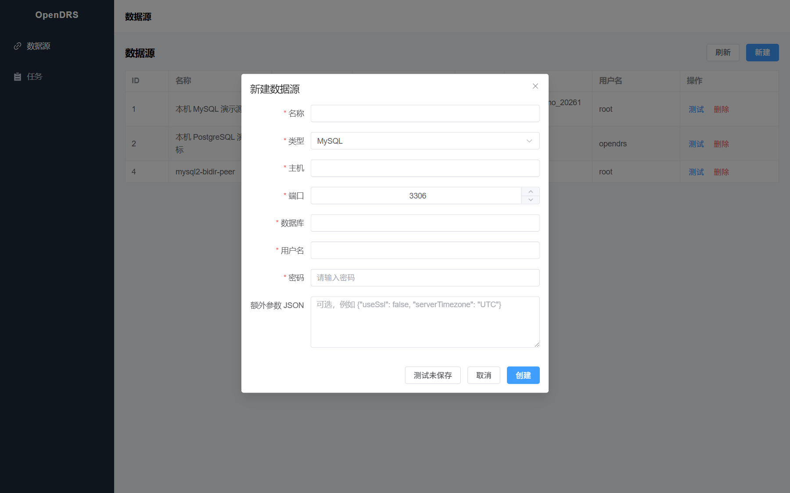

### 2. 新建任务

**任务管理 → 新建任务**，五步向导：

1. **基本信息** — 任务名称、迁移模式（全量+增量 / 仅全量）
2. **设置同步** — 源/目标数据源、同步拓扑（单向 / 双向）、同步对象（整库 / 按表）
3. **高级设置** — 导出/导入并发数、回放并发数、冲突策略等
4. **预检查** — 异步执行，结果逐项刷新；阻断项必须解决
5. **任务确认** — 确认后任务进入「未启动」

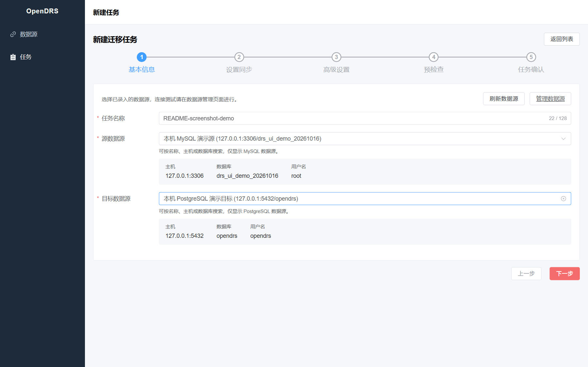

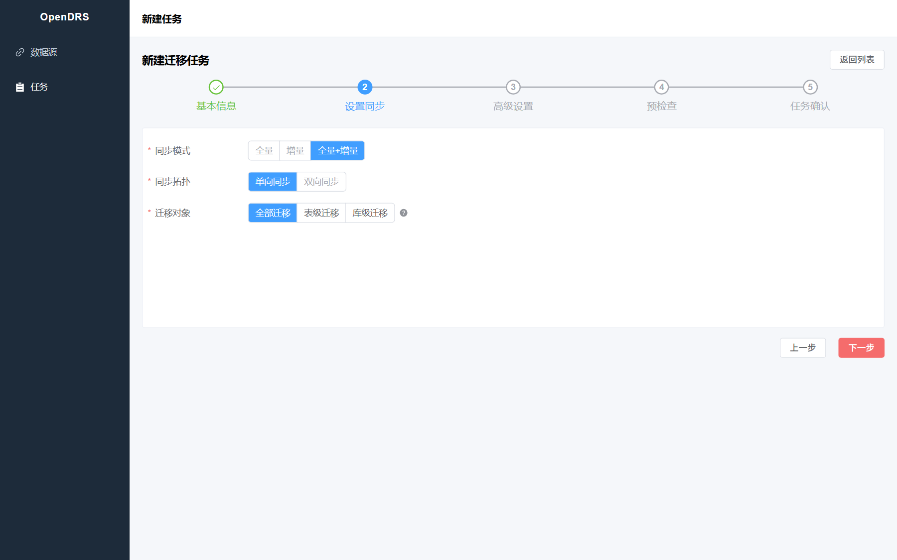

表级迁移可展开库、勾选具体表（左侧未选、右侧已选）：

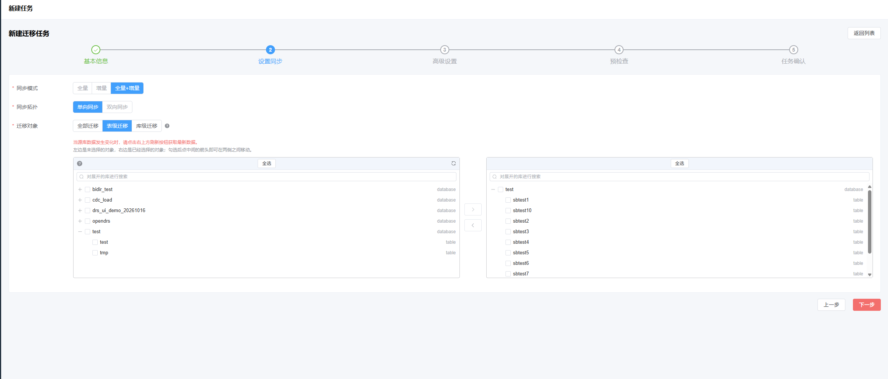

库级迁移按整库勾选：

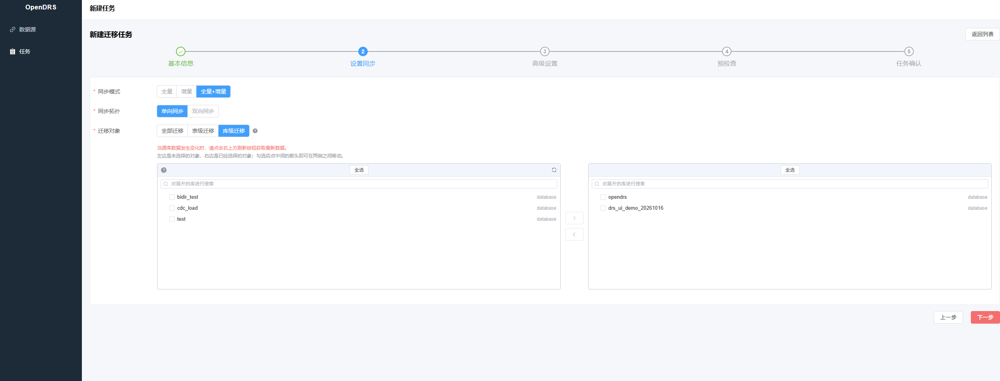

两端均为 MySQL 时可选「双向同步」：

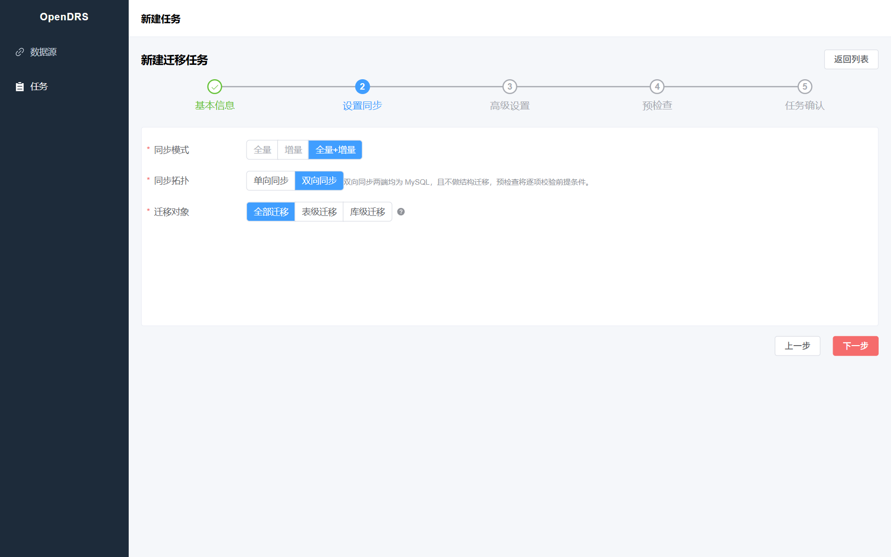

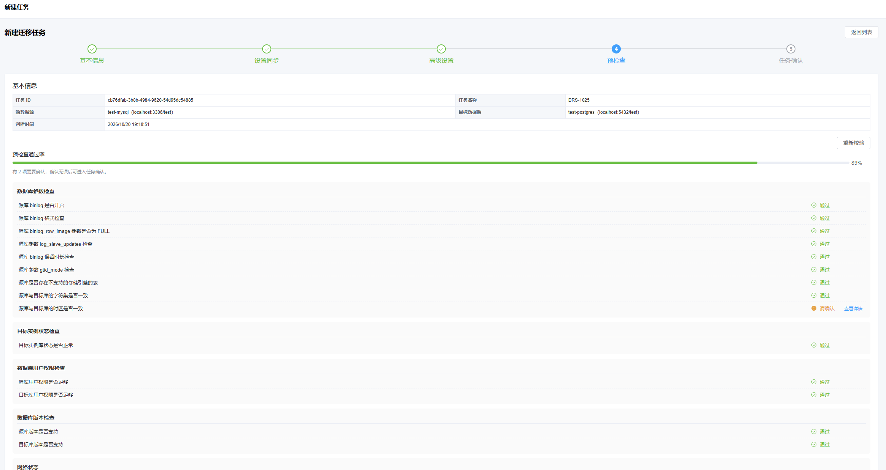

预检查通过后确认任务信息并启动：

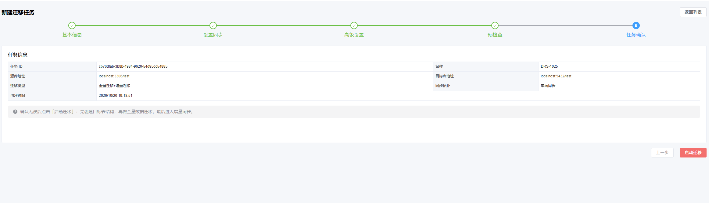

### 3. 启动与运维

任务列表按状态提供操作（不可用的置灰）：

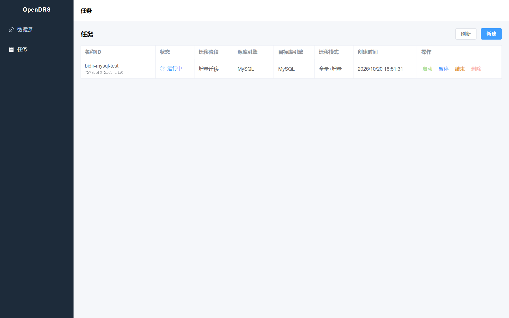

| 状态 | 可用操作 |
|---|---|
| 未启动 | 启动、结束 |
| 运行中 | 暂停（仅增量阶段）、结束 |
| 已暂停 | 恢复、结束 |
| 失败 | 重启、结束 |
| 已结束 | 删除 |

- **暂停**：停止 CDC 但保留断点，恢复后从原位置继续。
- **结束**：释放任务资源；结束后只能删除。

### 4. 观察任务

任务详情页三个页签：

- **基本信息** — 任务/实例信息 + 迁移进度（源位点、抓取位点、回放位点、回放时延；双向任务分正向/反向两块）

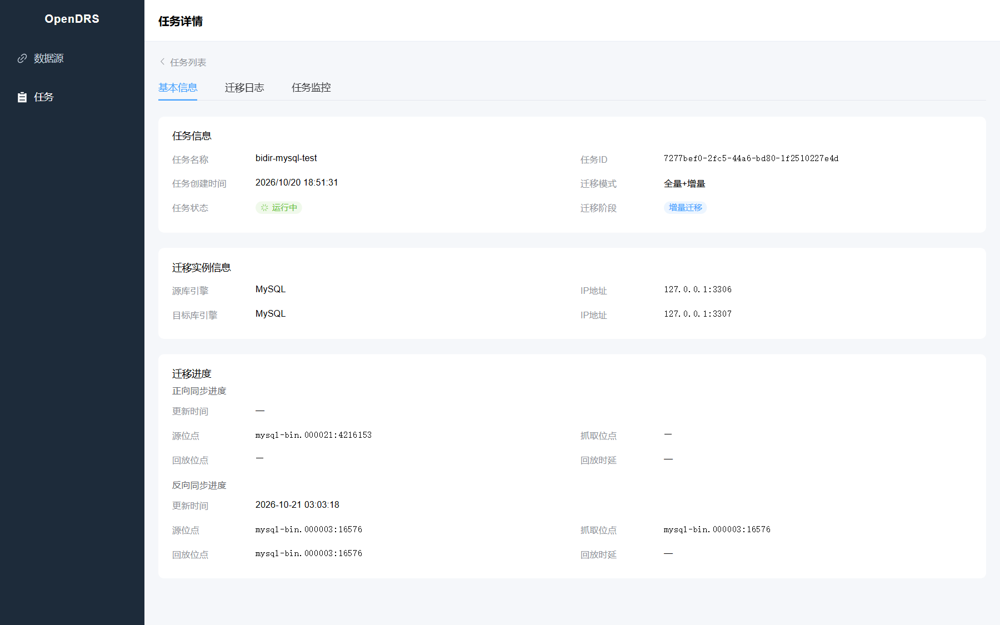

- **迁移日志** — 引擎与任务日志，可按级别筛选
- **任务监控** — 目标库回放 TPS（count/s）、数据同步时延（s）、事务平均执行/提交耗时

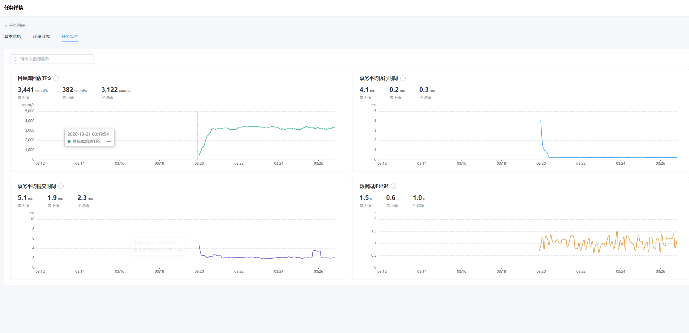

## 支持的同步方式

### 单向同步：MySQL → PostgreSQL

最常用的迁移场景：存量数据全量搬迁，之后持续跟随 binlog 增量回放。

前提（预检查会逐项校验）：

- 源库 binlog 开启，格式 `binlog_format=ROW`、`binlog_row_image=FULL`，保留时长充足（默认要求 ≥ 3 天）
- 所选表均为 InnoDB 引擎，且**均有主键**（增量回放按主键定位行）
- 源用户具备 SELECT、RELOAD、REPLICATION SLAVE、REPLICATION CLIENT、SHOW DATABASES 权限
- 目标 PostgreSQL 实例可连接、状态正常
- 迁移模式支持「全量+增量」与「仅全量」；全量阶段自动在目标库建表（MySQL DDL 自动转换为 PostgreSQL）

### 双向同步：MySQL ↔ MySQL

两个方向各自独立同步（均为全量+增量），适合双 region 各写本地、数据互备的场景。

前提（预检查会逐项校验）：

- 两端均为 MySQL，GTID 开启（`gtid_mode=ON`、`enforce_gtid-consistency=ON`）
- 两端 `server_id` / `server_uuid` 必须不同
- 两端用户均具备 CDC 权限（SELECT、REPLICATION SLAVE、REPLICATION CLIENT、SHOW DATABASES 等）
- **两端表结构已存在**（双向不做结构迁移）
- 同步模式必须为「全量+增量」

防回环原理：sink 回放事务时通过 `SET SESSION gtid_next` 把源端 GTID（增量）或任务级合成 GTID 命名空间（全量批次）写入目标 binlog；对端捕获按 GTID UUID 丢弃来自 peer 的事务。当前版本假设各自 region 只写本 region 的数据，不做跨 region 冲突检测。

## API 概览

统一前缀 `/api/v1/migration`，响应包 `{code, message, data}`（1000 成功）。示例：

```bash
# 列出数据源
curl http://localhost/api/v1/migration/connections

# 新建数据源
curl -X POST http://localhost/api/v1/migration/connections \
  -H 'Content-Type: application/json' \
  -d '{"name":"my-mysql","connection":{"type":"MYSQL","host":"127.0.0.1","port":3406,
       "database":"demo","username":"root","password":"123456",
       "extra":{"allowPublicKeyRetrieval":true}}}'

# 任务生命周期
curl -X POST http://localhost/api/v1/migration/tasks/{id}/precheck
curl -X POST http://localhost/api/v1/migration/tasks/{id}/start
curl -X POST http://localhost/api/v1/migration/tasks/{id}/stop      # 暂停
curl -X POST http://localhost/api/v1/migration/tasks/{id}/start     # 恢复（已暂停时）
curl -X POST http://localhost/api/v1/migration/tasks/{id}/terminate # 结束
curl -X DELETE http://localhost/api/v1/migration/tasks/{id}         # 删除（须已结束）

# 状态与观测
curl http://localhost/api/v1/migration/tasks/{id}/status
curl http://localhost/api/v1/migration/tasks/{id}/precheck
curl 'http://localhost/api/v1/migration/tasks/{id}/logs?page=1&size=50'
```

## 本地开发

```bash
# 后端：编译 / 测试 / 打包
mvn compile
mvn test                      # 单测；端到端用例走 scripts/test framework（需容器）
mvn -DskipTests package

# 前端：热更新开发（代理 /api 到 :8080）
cd opendrs-web && npm run dev     # http://localhost:5173

# 修改后重新部署（等价于 dev.sh 的构建部分）
mvn -q -DskipTests package && (cd opendrs-web && npm run build) \
  && docker compose up -d --build
```

## 架构速览

Maven 多模块，`io.opendrs`：

- `opendrs-engine` — 无框架引擎层，对外只有 `MigrationEngine` 四个方法（`supportsPrecheck` / `migrateSchema` / `migrateData` / `precheck`），句柄立即返回、阻塞跑在引擎自己的守护线程池：
  - `engine-capture` — 嵌入式 Debezium（MySQL binlog），offset / schema history 持久化在任务元数据库
  - `engine-replay` — JDBC 事务回放，PostgreSQL / MySQL 目标方言
  - `engine-precheck` — 规则化预检查（按 源→目标 类型匹配 profile）
  - `engine-core` — 编排与表选择/映射
- `opendrs-service` — Spring Boot：任务状态机（`job_phase` 阶段 × `job_state` 状态）、异步预检、任务调度、监控指标、MyBatis + Flyway
- `opendrs-web` — Vue 3 + Element Plus + ECharts（非 Maven 模块，`npm run build` 产出由 nginx 挂载）
- `opendrs-jdbc` / `opendrs-common` — 连接与方言基础设施、共享元数据类型

## License

[Apache License 2.0](LICENSE)。

CDC 嵌入 [Debezium](https://debezium.io)（Apache 2.0）。第三方归属见 [NOTICE](NOTICE)。
