# OpenDRS

Open data replication service（开源数据复制服务）。通过 Web 界面完成 **MySQL → PostgreSQL** 的全量 + 增量迁移、**MySQL ↔ MySQL 双向同步**，以及迁移后的**逐行数据校验**。增量基于嵌入式 Debezium 读取 binlog，目标端按事务回放。

## 功能

| 能力 | 说明 |
|---|---|
| 全量迁移 | 初始快照逐行复制，无需单独的导出/导入回合 |
| 增量迁移 | binlog CDC，快照完成后自动接续，任务持续运行 |
| 结构迁移 | 单向任务自动在目标库建表（MySQL DDL → PostgreSQL）；双向任务要求两端表已存在 |
| 预检查 | 异步执行：连接、版本、权限、binlog/GTID 参数、主键、目标实例状态、表存在性等，逐项通过/告警/阻断 |
| 双向同步 | 两个方向各自全量+增量；GTID 打标 + 对端过滤防止回环 |
| 任务监控 | 目标库回放 TPS、同步时延、事务执行/提交耗时（Prometheus 指标 + ECharts 展示） |
| 任务状态机 | 启动 / 暂停（仅增量）/ 恢复 / 重启 / 结束 / 删除，非法操作置灰 |
| 数据校验 | 对迁移范围内的表逐行比对源/目标内容，按表统计「不一致 / 仅源端 / 仅目标端」并分页查看明细（当前仅全量） |

## 快速开始

要求：Docker（或 Podman）+ Docker Compose、JDK 21、Maven 3.8+、Node.js 18+。

```bash
# 一键构建并启动全部服务（服务 jar + 前端 bundle + compose 重建）
sh deploy/dev.sh
```

启动完成后访问 **http://localhost**（nginx 反代 `/api` 到 opendrs-service）。`dev.sh` 末尾会自动探测 `http://127.0.0.1/api/v1/migration/connections` 直到就绪。

compose 应用栈包含：

| 服务 | 端口 | 说明 |
|---|---|---|
| frontend (nginx) | 80 | Web UI + API 反代 |
| opendrs-service | 8080 | Spring Boot 服务：迁移 + 数据校验（host 网络） |
| mysql | 3406 | 服务元数据库（root/123456，库 `opendrs`） |
| prometheus | 9090 | 回放指标采集 |

需要真实数据源时，额外启动 `scripts/test/docker-compose.yml`（或 `scripts/test/data-sources.sh`）：

| 服务 | 端口 | 说明 |
|---|---|---|
| e2e-mysql1 | 3306 | binlog + GTID 开启的 MySQL 源库（e2e_mysql/123456，库 `e2e_db`） |
| e2e-postgres1 | 5432 | PostgreSQL 目标库（e2e_postgres/123456，库 `e2e_db`） |

## 使用流程

### 1. 准备数据源

**数据源管理 → 新增数据源**，填写主机、端口、数据库、用户名、密码。

- MySQL 8 非 SSL 连接需在「高级配置」中加 `"allowPublicKeyRetrieval": true`（caching_sha2_password 公钥检索）。
- 建议先点「测试连接」。

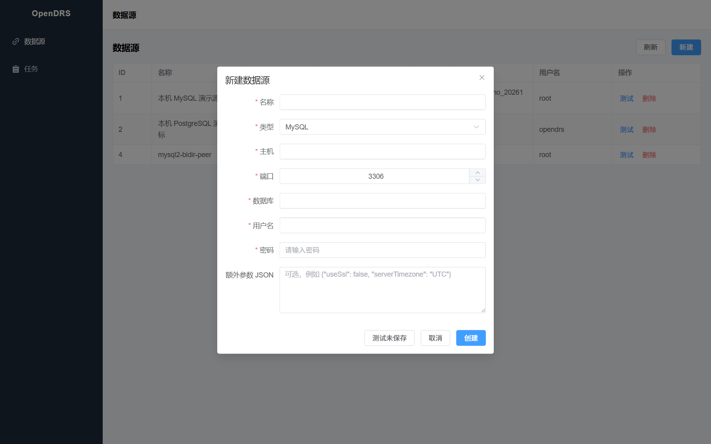

### 2. 新建任务

**任务管理 → 新建任务**，五步向导：

1. **基本信息** — 任务名称、迁移模式（全量+增量 / 仅全量）
2. **设置同步** — 源/目标数据源、同步拓扑（单向 / 双向）、同步对象（整库 / 按表）
3. **高级设置** — 导出/导入并发数、回放并发数、冲突策略等
4. **预检查** — 异步执行，结果逐项刷新；阻断项必须解决
5. **任务确认** — 确认后任务进入「未启动」

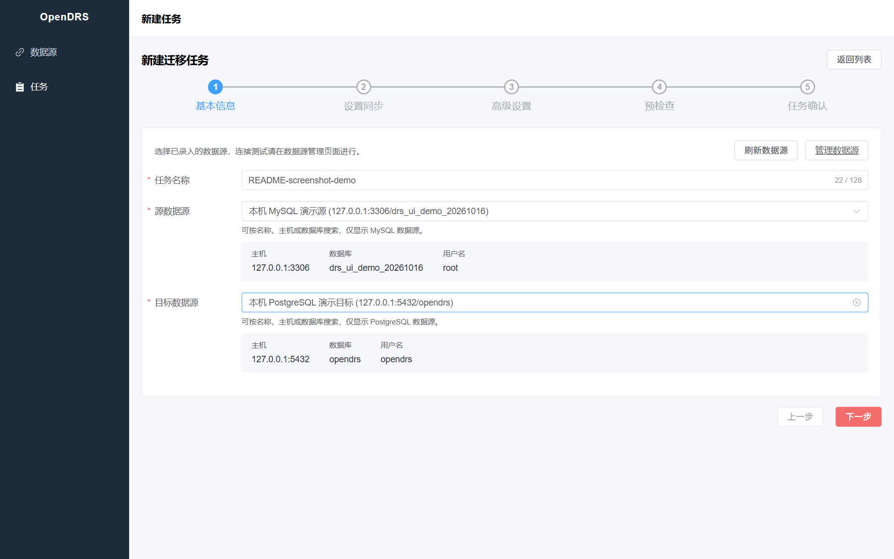

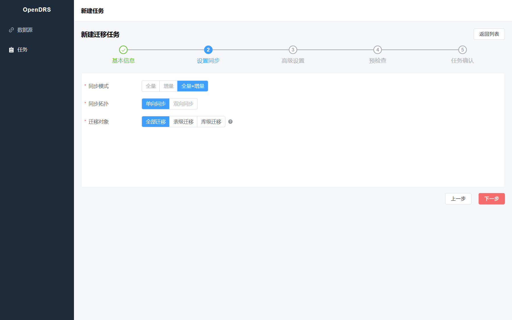

表级迁移可展开库、勾选具体表（左侧未选、右侧已选）：

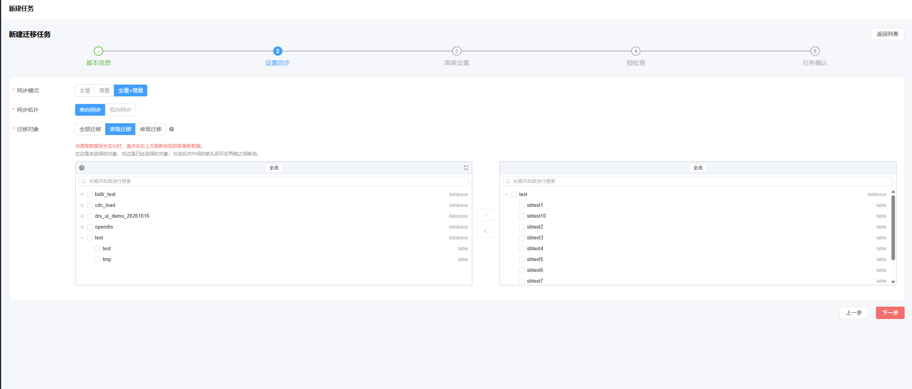

库级迁移按整库勾选：

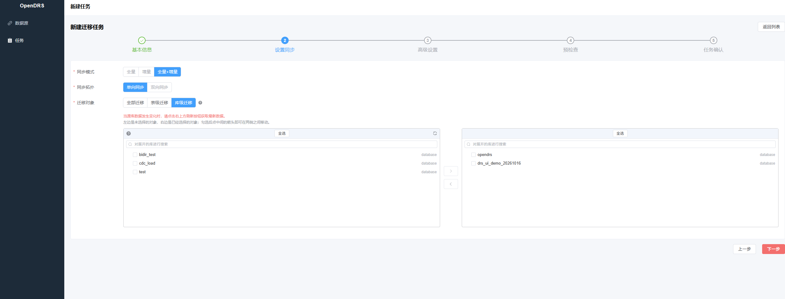

两端均为 MySQL 时可选「双向同步」：

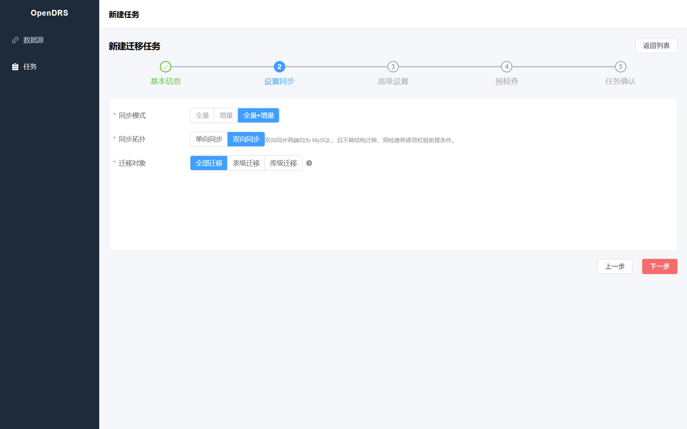

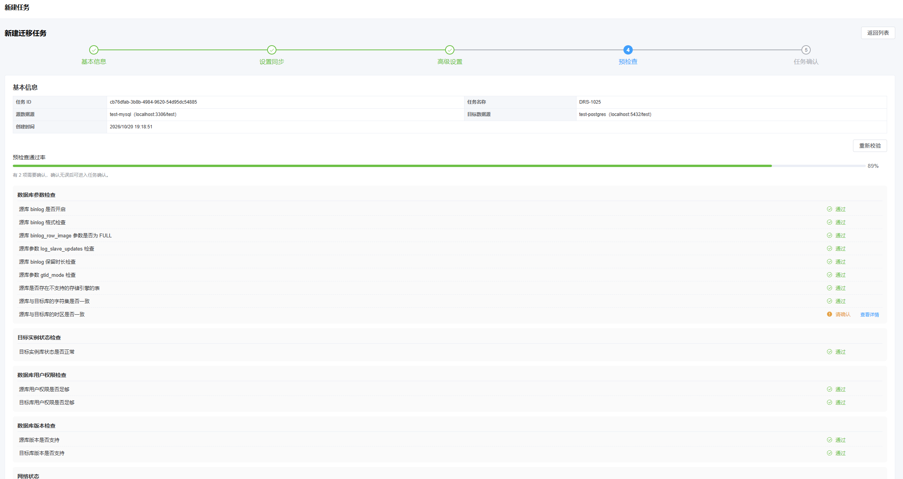

预检查通过后确认任务信息并启动：

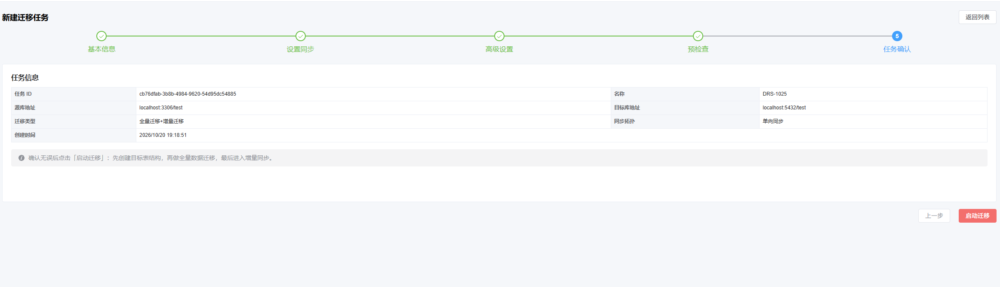

### 3. 启动与运维

任务列表按状态提供操作（不可用的置灰）：

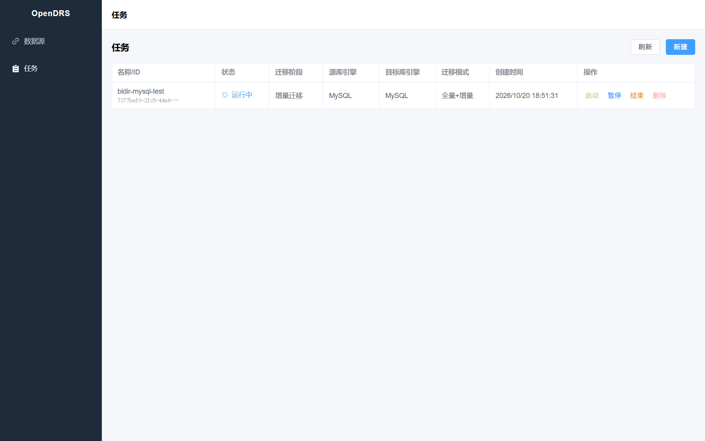

| 状态 | 可用操作 |
|---|---|
| 未启动 | 启动、结束 |
| 运行中 | 暂停（仅增量阶段）、结束 |
| 已暂停 | 恢复、结束 |
| 失败 | 重启、结束 |
| 已结束 | 删除 |

- **暂停**：停止 CDC 但保留断点，恢复后从原位置继续。
- **结束**：释放任务资源；结束后只能删除。

### 4. 观察任务

任务详情页四个页签：

- **基本信息** — 任务/实例信息 + 迁移进度（源位点、抓取位点、回放位点、回放时延；双向任务分正向/反向两块）

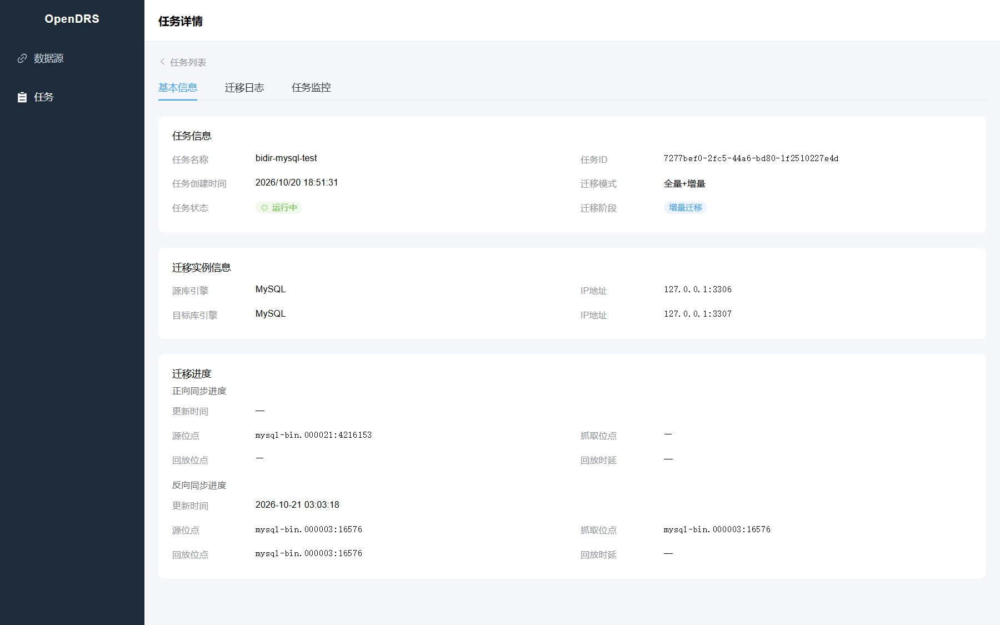

- **数据校验** — 创建并查看该迁移任务下的逐行内容对比，见 [5. 数据校验](#5-数据校验)
- **迁移日志** — 引擎与任务日志，可按级别筛选
- **任务监控** — 目标库回放 TPS（count/s）、数据同步时延（s）、事务平均执行/提交耗时

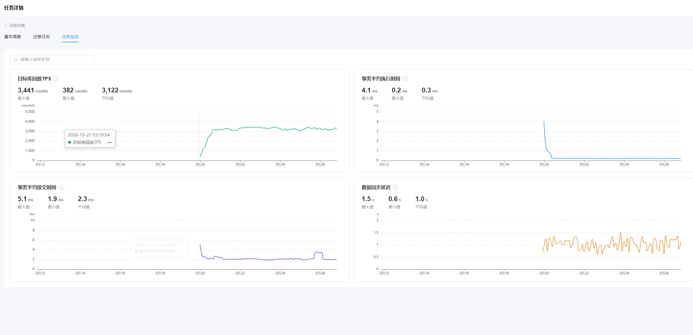

### 5. 数据校验

迁移任务详情页的 **数据校验** 页签用于确认源/目标内容是否一致：

- **创建** — 输入任务名称，选择对比类型（当前仅「内容对比」；行数对比暂不支持），在穿梭框中勾选要校验的源表。可选的源表受父迁移任务的同步范围限制，目标表按迁移映射自动解析并在创建时固化。
- **模式** — 当前仅支持全量内容对比（`FULL_ONLY`）；增量对比尚未实现，创建页不可选。
- **执行** — 每张表独立执行：按主键排序流式读取两端、逐行归一化比对，不一致行写入该任务独立的结果表。
- **报表** — 按表显示状态与差异数量，可按「不一致 / 仅源端 / 仅目标端」筛选，结果按主键分页；报告导出暂不支持。
- **注意** — 校验期间对目标库的额外写入会影响结果准确性；无主键的表不参与校验。

## 支持的同步方式

### 单向同步：MySQL → PostgreSQL

最常用的迁移场景：存量数据全量搬迁，之后持续跟随 binlog 增量回放。

前提（预检查会逐项校验）：

- 源库 binlog 开启，格式 `binlog_format=ROW`、`binlog_row_image=FULL`，保留时长充足（默认要求 ≥ 3 天）
- 所选表均为 InnoDB 引擎，且**均有主键**（增量回放按主键定位行）
- 源用户具备 SELECT、RELOAD、REPLICATION SLAVE、REPLICATION CLIENT、SHOW DATABASES 权限
- 目标 PostgreSQL 实例可连接、状态正常
- 迁移模式支持「全量+增量」与「仅全量」；全量阶段自动在目标库建表（MySQL DDL 自动转换为 PostgreSQL）

### 双向同步：MySQL ↔ MySQL

两个方向各自独立同步（均为全量+增量），适合双 region 各写本地、数据互备的场景。

前提（预检查会逐项校验）：

- 两端均为 MySQL，GTID 开启（`gtid_mode=ON`、`enforce_gtid-consistency=ON`）
- 两端 `server_id` / `server_uuid` 必须不同
- 两端用户均具备 CDC 权限（SELECT、REPLICATION SLAVE、REPLICATION CLIENT、SHOW DATABASES 等）
- **两端表结构已存在**（双向不做结构迁移）
- 同步模式必须为「全量+增量」

防回环原理：sink 回放事务时通过 `SET SESSION gtid_next` 把源端 GTID（增量）或任务级合成 GTID 命名空间（全量批次）写入目标 binlog；对端捕获按 GTID UUID 丢弃来自 peer 的事务。当前版本假设各自 region 只写本 region 的数据，不做跨 region 冲突检测。

## API 概览

统一响应包 `{code, message, data}`（1000 成功）。迁移接口前缀 `/api/v1/migration`，数据校验接口前缀 `/api/v1/datacheck`。示例：

```bash
# 列出数据源
curl http://localhost/api/v1/migration/connections

# 新建数据源
curl -X POST http://localhost/api/v1/migration/connections \
  -H 'Content-Type: application/json' \
  -d '{"name":"my-mysql","connection":{"type":"MYSQL","host":"127.0.0.1","port":3406,
       "database":"demo","username":"root","password":"123456",
       "extra":{"allowPublicKeyRetrieval":true}}}'

# 任务生命周期
curl -X POST http://localhost/api/v1/migration/tasks/{id}/precheck
curl -X POST http://localhost/api/v1/migration/tasks/{id}/start
curl -X POST http://localhost/api/v1/migration/tasks/{id}/stop      # 暂停
curl -X POST http://localhost/api/v1/migration/tasks/{id}/start     # 恢复（已暂停时）
curl -X POST http://localhost/api/v1/migration/tasks/{id}/terminate # 结束
curl -X DELETE http://localhost/api/v1/migration/tasks/{id}         # 删除（须已结束）

# 状态与观测
curl http://localhost/api/v1/migration/tasks/{id}/status
curl http://localhost/api/v1/migration/tasks/{id}/precheck
curl 'http://localhost/api/v1/migration/tasks/{id}/logs?page=1&size=50'
```

### 数据校验

```bash
# 列出父迁移任务下的校验任务 / 可校验的源对象
curl 'http://localhost/api/v1/datacheck/tasks?migrationTaskId=1'
curl 'http://localhost/api/v1/datacheck/tasks/candidates?migrationTaskId=1'

# 创建（当前仅全量内容对比）
curl -X POST http://localhost/api/v1/datacheck/tasks \
  -H 'Content-Type: application/json' \
  -d '{"migrationTaskId":1,"name":"check-sample","mode":"FULL_ONLY",
       "tables":[{"schema":"test","table":"sample"}]}'

# 生命周期与结果
curl -X POST http://localhost/api/v1/datacheck/tasks/{id}/start
curl -X POST http://localhost/api/v1/datacheck/tasks/{id}/stop       # 暂停
curl -X POST http://localhost/api/v1/datacheck/tasks/{id}/terminate  # 结束
curl http://localhost/api/v1/datacheck/tasks/{id}/tables
curl 'http://localhost/api/v1/datacheck/tasks/{id}/results?tableId=test.sample&flag=0&page=1&size=20'
```

`flag`：`0` 不一致、`1` 仅源端、`2` 仅目标端，省略表示全部。

## 本地开发

```bash
# 服务：编译 / 测试 / 打包
mvn compile
mvn test                      # 单测；端到端用例走 scripts/test framework（需容器）
mvn -DskipTests package

# 启动服务（迁移 + 数据校验同进程）
mvn -pl opendrs-service -am -DskipTests package
java -jar opendrs-service/target/opendrs-service-*.jar

# 前端：热更新开发（代理 /api 到 :8080）
cd opendrs-web && npm run dev     # http://localhost:5173

# 修改后重新部署
sh deploy/dev.sh
```

## 架构速览

Maven 多模块，`io.opendrs`：

- `opendrs-engine` — 无框架引擎层，对外只有 `MigrationEngine` 五个方法（`supportsPrecheck` / `migrateSchema` / `migrateData` / `precheck` / `datacheck`），句柄立即返回、阻塞跑在引擎自己的守护线程池：
  - `engine-common` — 元数据、表选择/映射、命名策略、日志与工具
  - `engine-jdbc` — 连接生命周期与元数据读取（MySQL / PostgreSQL / Oracle）
  - `engine-schema` — 结构迁移：从源库 DDL 生成目标表/索引/约束，供全量与增量 DDL 复用
  - `engine-capture` — 嵌入式 Debezium（MySQL binlog），offset / schema history 持久化在任务元数据库
  - `engine-replay` — JDBC 事务回放，PostgreSQL / MySQL 目标方言
  - `engine-precheck` — 规则化预检查（按 源→目标 类型匹配 profile）
  - `engine-datacheck` — 行内容校验：按主键排序流读、归一化与差异落库
  - `engine-core` — 编排与表选择/映射
- `opendrs-service` — 唯一的 Spring Boot 应用：迁移任务状态机（`job_phase` 阶段 × `job_state` 状态）、异步预检、任务调度、监控指标、MyBatis + Flyway，以及数据校验编排与不一致行查询（`io.opendrs.migration.*` 与 `io.opendrs.datacheck.*` 同一进程，默认端口 8080）
- `opendrs-web` — Vue 3 + Element Plus + ECharts（非 Maven 模块，`npm run build` 产出由 nginx 挂载）
- `opendrs-common` — 跨模块共享的 API 响应包、错误码与 i18n 消息，以及引擎向 service 汇报的进度回调

## License

[Apache License 2.0](LICENSE)。

CDC 嵌入 [Debezium](https://debezium.io)（Apache 2.0）。第三方归属见 [NOTICE](NOTICE)。

## Kafka 传输通道（可选）

默认仍是 **DIRECT**（apply 后才 mark `debezium_offsets`）。若要走 Kafka 缓冲（**仅增量 CDC**；全量/snapshot 始终进程内 DIRECT）：

1. `deploy/docker-compose.yml` 已包含 `opendrs-kafka`（9092）与 `opendrs-apicurio`（8081，官方镜像）。
2. 通道选择（`CdcTransportSpec`：`DIRECT` | `KAFKA`）：
   - **任务级**：`options.cdcTransportSpec`（可空；创建时写入 `options_json`）
   - 否则 **全局**：`OPENDRS_TRANSPORT_CHANNEL` / `opendrs.transport.channel`（默认 `DIRECT`）
3. topic / group 由 `task_pipelines.public_id` 派生：`opendrs.pipeline.{id}` / `opendrs.replay.{id}`；bootstrap / schema registry 仍用全局配置。
4. 序列化为 Connect JSON envelope（保真 Debezium `SourceRecord`），**不是** demo 的 flat Avro。
5. KAFKA 位点刷盘为纯定时 3s；replay 的 `commitAsync` 仅在成功回调后清 pending，失败留待下次或停任务 `commitSync`。

详见 [`docs/kafka-transport-plan.md`](docs/kafka-transport-plan.md)。

