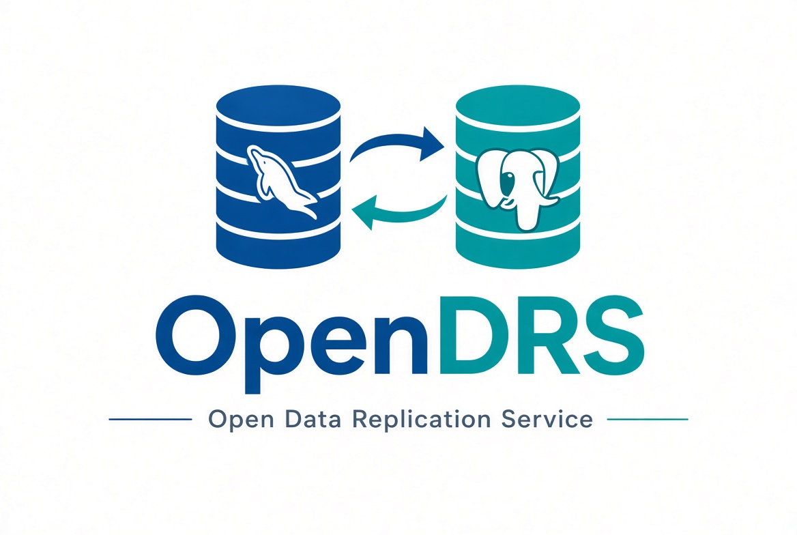
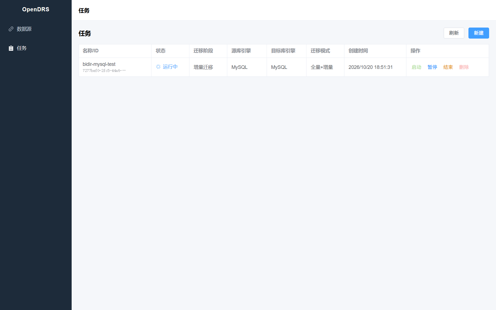
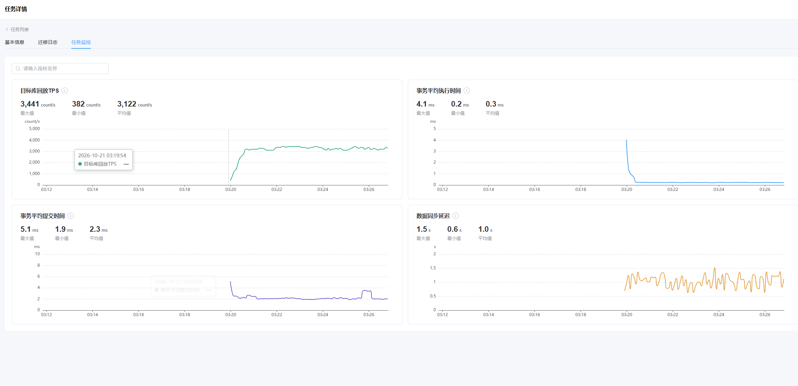
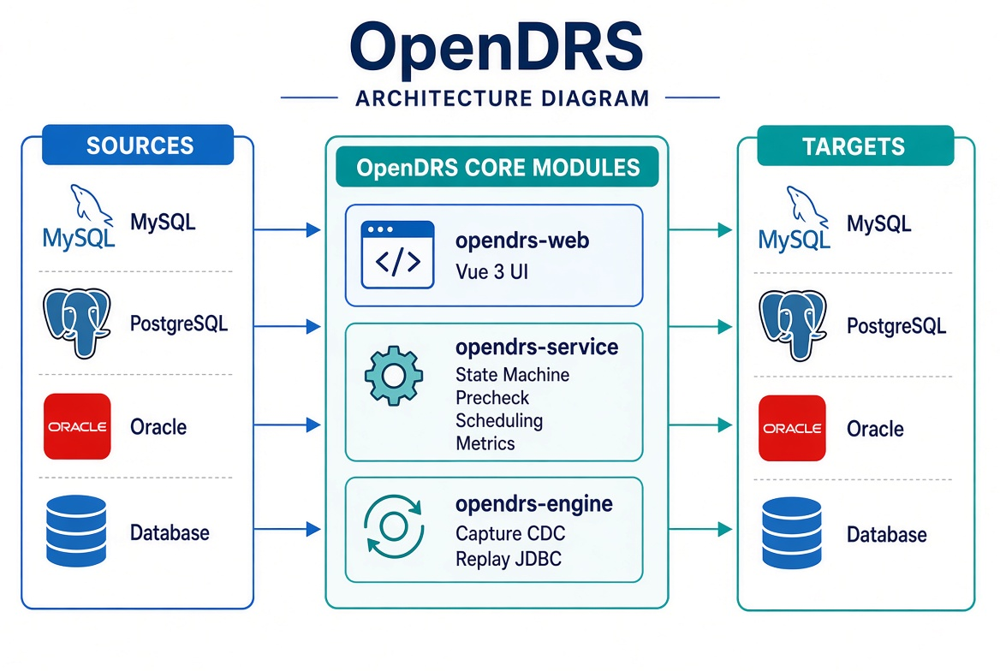
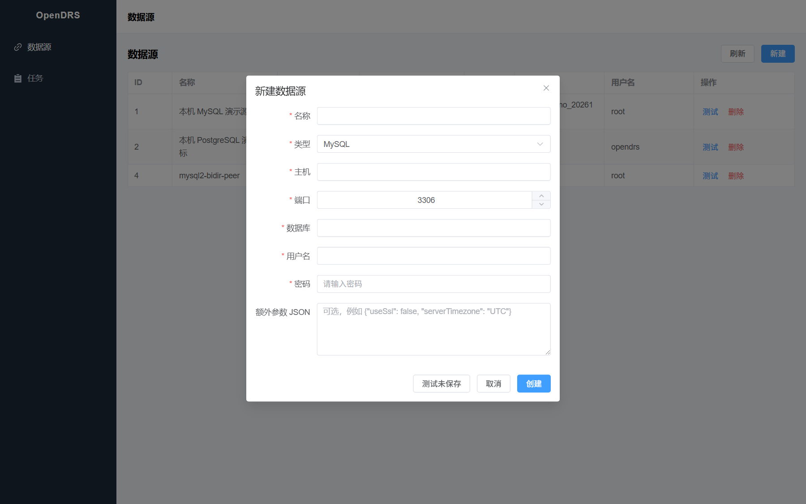
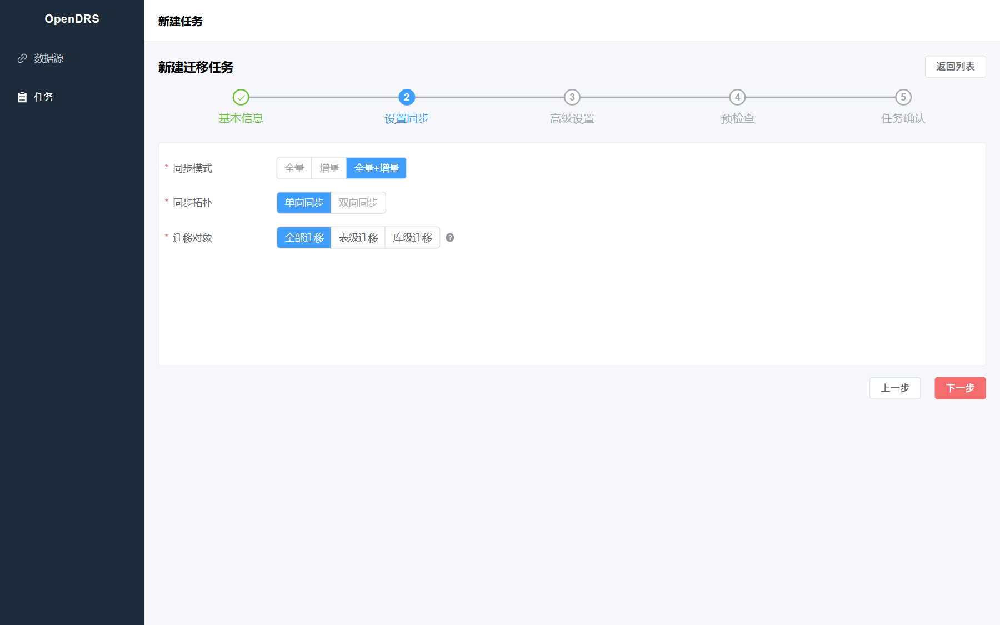
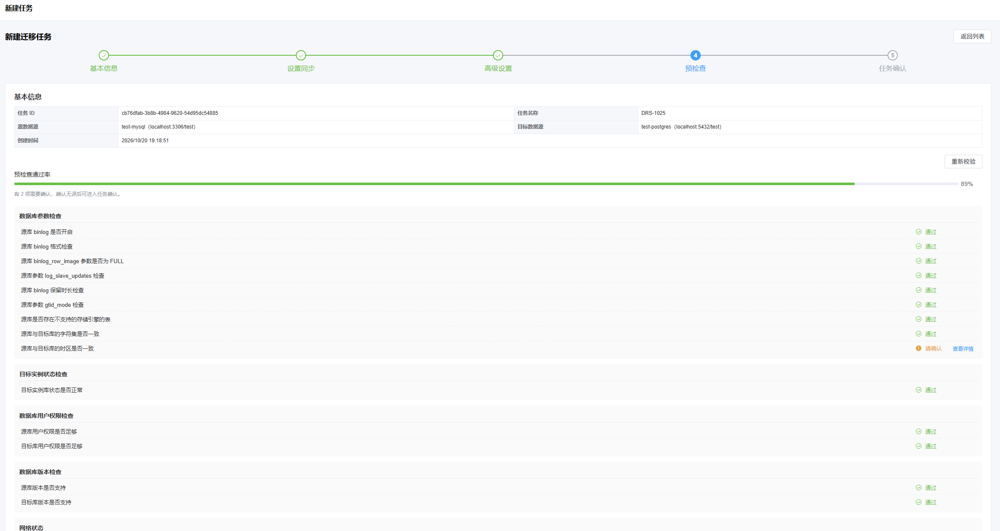
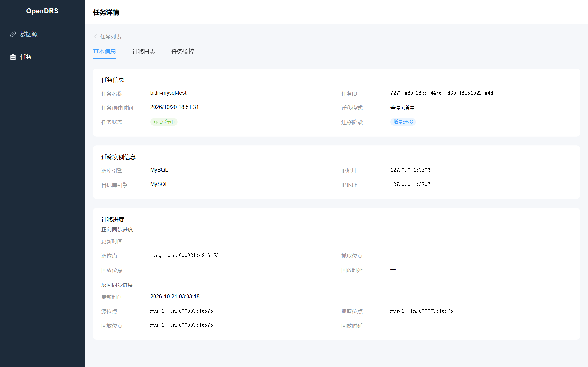

<p align="center">
  
</p>

[English](README.md) | 简体中文

**Open Data Replication Service** — 面向异构数据库的开源数据复制平台，用中英双语 Web 界面完成全量迁移与增量同步。

开源数据复制服务。在浏览器里配置数据源和任务，引擎负责捕获变更、在目标端按事务回放，并提供预检查、运维和迁移后的逐行数据校验——不必自己拼一套 CDC 连接器、消费端和运维界面。增量捕获当前使用嵌入式 [Debezium](https://debezium.io)。

已支持和计划中的源 / 目标组合见[支持的同步链路](#支持的同步链路)。

[](https://github.com/1149782339/OpenDRS/actions/workflows/ci.yml)
[](LICENSE)
[](https://openjdk.org/projects/jdk/21/)
[](https://debezium.io)





<!-- TODO（可选）: 用 10～20 秒的 GIF 替换上面两张静态图，演示「新建任务 → 预检查通过 → 跑起来 → 监控出数」 -->

## 目录

- [要解决的问题](#要解决的问题)
- [特性](#特性)
- [适用场景](#适用场景)
- [架构](#架构)
- [支持的同步链路](#支持的同步链路)
- [快速开始](#快速开始)
- [使用流程](#使用流程)
- [定位对比](#定位对比)
- [当前限制](#当前限制)
- [API 与本地开发](#api-与本地开发)
- [路线图](#路线图)
- [贡献](#贡献)
- [License](#license)

## 要解决的问题

在异构数据库之间做复制，或在同类实例之间互相同步，常见做法是自己拼链路：用 CDC 工具抓变更，再写一套 sink，再补预检查、断点、监控和界面。链路能跑，但组装和排障成本很高。

OpenDRS 把这条链路收成一个可部署的服务：在浏览器里配置数据源和任务，引擎负责快照、CDC、回放、数据校验和运维动作。

## 特性

- **全量 + 增量一条任务做完** — 初始快照逐行复制，完成后自动接上增量 CDC，不必再走一轮导出/导入。
- **支持的链路上可做结构迁移** — 若该方向已有结构转换器，单向任务可在目标库自动建表（当前为 MySQL DDL → PostgreSQL）。其他链路要求表已经存在。
- **预检查** — 连接、版本、权限、该链路相关的 CDC 参数、主键、目标实例状态、表存在性等，逐项通过 / 告警 / 阻断，阻断项必须先解决。
- **支持的链路上可做双向同步** — 两个方向各自全量 + 增量，并防止回环。当前可用于 MySQL ↔ MySQL（GTID 打标 + 对端过滤）。
- **任务可运维** — 启动 / 暂停（仅增量阶段）/ 恢复 / 重启 / 结束 / 删除；非法操作在界面上置灰。
- **中英双语界面** — 整个 Web 界面支持简体中文和英文，顶栏一键切换。
- **可观测** — 目标库回放 TPS、同步时延、事务执行 / 提交耗时（Prometheus 指标 + ECharts 展示）。
- **逐行数据校验** — 迁移全量完成之后，对选定表逐行比对源/目标内容。模式：仅全量、全量后接增量、或仅增量（增量需 Kafka 传输通道）。报表展示每张表的状态、差异数量和增量时延。

## 适用场景

- 在不同引擎之间做异构迁移，例如 MySQL → PostgreSQL：先搬存量，再持续跟随变更。
- 在已支持的双向链路上做双 region 互备（当前为 MySQL ↔ MySQL；本版本不做跨 region 冲突检测，见[当前限制](#当前限制)）。
- 只想搬一次存量、不需要持续同步（任务可选「仅全量」）。
- 迁移之后确认源/目标内容一致，可做全量校验、增量跟随，或两者都做。

## 架构

<p align="center">
  
</p>

捕获和回放按数据库类型选择。目前捕获通过嵌入式 Debezium 对接 MySQL，回放提供 PostgreSQL 与 MySQL 的 JDBC 方言。增量事件可以走进程内通道（`DIRECT`），也可以走 Kafka。已支持和计划中的组合见[支持的同步链路](#支持的同步链路)。

模块划分（Maven 多模块，坐标 `io.opendrs`）：

- **`opendrs-engine`**：无框架引擎，对外接口是 `MigrationEngine`（`supportsPrecheck` / `migrateSchema` / `migrateData` / `precheck` / `datacheck`）。句柄立即返回，阻塞工作跑在引擎自己的守护线程池。位点与 schema history 写在任务元数据库。子模块：
  - `engine-common`：元数据、表选择/映射、命名策略、日志与工具
  - `engine-jdbc`：连接生命周期与元数据读取（MySQL / PostgreSQL / Oracle）
  - `engine-schema`：结构迁移，从源库 DDL 生成目标表/索引/约束，供全量与增量 DDL 复用
  - `engine-capture`：CDC 与快照（当前为嵌入式 Debezium）
  - `engine-replay`：按目标方言做 JDBC 事务回放
  - `engine-precheck`：按源 → 目标类型匹配规则包
  - `engine-datacheck`：行内容校验，按主键排序流读、归一化、增量 Kafka 跟随与差异落库
  - `engine-core`：编排与表映射
- **`opendrs-service`**：唯一的 Spring Boot 应用，负责任务状态机（阶段 × 状态）、异步预检、调度、Prometheus 指标、MyBatis + Flyway，以及数据校验编排与不一致行查询（`io.opendrs.migration.*` 与 `io.opendrs.datacheck.*` 同一进程，默认端口 8080）。
- **`opendrs-web`**：Vue 3 + Element Plus + ECharts。不是 Maven 模块，`npm run build` 的产物由 nginx 挂载。
- **`opendrs-common`**：跨模块共享的 API 响应包、错误码与 i18n 消息，以及引擎向 service 汇报的进度回调。

全量断点续跑的设计见 [`docs/design/full-migration-resume.md`](docs/design/full-migration-resume.md)。

## 支持的同步链路

OpenDRS 按多源、多目标平台来设计。**已支持**表示该链路可以在 `main` 上创建并跑起来。**计划中**是示例性的后续方向，尚未实现；如果路线图有变，可以直接删改这一块。

| 源 | 目标 | 状态 | 说明 |
|---|---|---|---|
| MySQL | PostgreSQL | 已支持 | 单向。结构迁移（MySQL DDL → PostgreSQL）、全量快照、增量 CDC。模式：全量 + 增量，或仅全量。 |
| MySQL | MySQL | 已支持 | 全量快照与增量 CDC。可单向，也可双向（必须全量 + 增量）。不做结构迁移，两端表需已存在。双向用 GTID 打标防止回环。 |
| Oracle | PostgreSQL | 计划中 | |
| PostgreSQL | MySQL | 计划中 | |
| MySQL | Oracle | 计划中 | |

### 当前已支持链路的前提

以下约束适用于上表中的**已支持**行（目前源端都是 MySQL）。预检查会覆盖其中大部分：

- 源库 binlog 须为 `ROW` + `FULL`，保留时长充足（预检查默认要求 ≥ 3 天）。表应为 InnoDB。增量回放按主键定位行。
- 源用户权限：`SELECT`、`RELOAD`、`REPLICATION SLAVE`、`REPLICATION CLIENT`、`SHOW DATABASES`。
- MySQL → MySQL 还要求源端开启 GTID（`gtid_mode=ON`）。双向时两端都要具备 GTID 和 CDC 权限，且 `server_id` / `server_uuid` 不同。
- 双向防回环：sink 回放时通过 `SET SESSION gtid_next` 把源端 GTID（增量）或任务级合成 GTID 命名空间（全量批次）写入目标 binlog，对端捕获按 GTID UUID 丢弃来自 peer 的事务。

## 快速开始

环境：Docker（或 Podman）+ Docker Compose、JDK 21、Maven 3.8+、Node.js 18+。

```bash
git clone https://github.com/1149782339/OpenDRS.git
cd OpenDRS
sh deploy/dev.sh
```

脚本会在本机编译服务 jar、打包前端，再重建应用 compose 栈，并探测 `http://127.0.0.1/api/v1/migration/connections` 直到就绪。然后打开 **http://localhost**（nginx 把 `/api` 反代到 `opendrs-service`）。

`deploy/dev.sh` 拉起的应用栈：

| 服务 | 端口 | 说明 |
|---|---|---|
| frontend (nginx) | 80 | Web UI + API 反代 |
| opendrs-service | 8080 | Spring Boot 服务：迁移 + 数据校验（host 网络） |
| mysql | 3406 | 服务元数据库（`root` / `123456` 或 `opendrs` / `123456`，库 `opendrs`） |
| prometheus | 9090 | 回放指标采集 |

默认 CDC 传输是进程内通道（`DIRECT`）。增量数据校验需要 Kafka 传输通道；可用下面的命令一并拉起 Kafka 和 Schema Registry：

```bash
OPENDRS_TRANSPORT_CHANNEL=KAFKA sh deploy/dev.sh
```

| 服务 | 端口 | 说明 |
|---|---|---|
| kafka | 9092 | 管道 topic 缓冲（compose profile `kafka`） |
| apicurio | 8081 | Schema Registry |

`dev.sh` **不会**启动迁移用的演示数据源。附带的演示走的是一条已支持链路（MySQL → PostgreSQL）。若要在本地试用，请再执行 `./scripts/test/data-sources.sh`（或 `scripts/test/docker-compose.yml`）：

```bash
./scripts/test/data-sources.sh
```

| 服务 | 端口 | 说明 |
|---|---|---|
| e2e-mysql1 | 3306 | 演示 / e2e 源库（`root` / `123456` 或 `e2e_mysql` / `123456`，库 `e2e_db`） |
| e2e-postgres1 | 5432 | 演示 / e2e 目标库（`e2e_postgres` / `123456`，库 `e2e_db`） |

在界面的「数据源管理」里填这些地址即可。MySQL 源端用 `root` 已具备预检查要求的 CDC 权限；`e2e_mysql` 需要先授予相应权限，全量 + 增量任务才能通过预检查。双向 MySQL ↔ MySQL 还需要第二台 MySQL，当前演示栈没有附带。

## 使用流程

### 1. 准备数据源

**数据源管理 → 新增数据源**，填写主机、端口、数据库、用户名、密码。建议先点「测试连接」。

MySQL 8 非 SSL 连接需在「高级配置」中加上 `"allowPublicKeyRetrieval": true`（`caching_sha2_password` 公钥检索）。



### 2. 新建任务

**任务管理 → 新建任务**，五步向导：基本信息 → 设置同步 → 高级设置 → 预检查 → 确认。确认后任务进入「未启动」。请选择一条[已支持的同步链路](#支持的同步链路)。





可按整库或按表勾选对象；两端都是 MySQL 时可以选择双向同步。更多界面见 `docs/images/`（基本信息、表级 / 库级选择、双向、确认）。

### 3. 启动、暂停与观察

| 状态 | 可用操作 |
|---|---|
| 未启动 | 启动、结束 |
| 运行中 | 暂停（仅增量阶段）、结束 |
| 已暂停 | 恢复、结束 |
| 失败 | 重启、结束 |
| 已结束 | 删除 |

- **暂停**：停止 CDC 但保留断点，恢复后从原位置继续。
- **结束**：释放任务资源；结束后只能删除。

任务详情页有四个页签。「基本信息」可以看到源位点、抓取位点、回放位点，以及端到端 / 捕获 / 回放时延（双向任务分正向 / 反向）；「数据校验」见下一节；「迁移日志」可按级别筛选；「任务监控」展示回放 TPS、同步时延和事务耗时。




### 4. 数据校验

数据校验任务只能在父迁移任务的全量迁移完成之后创建（迁移已进入增量阶段，或仅全量迁移已完成）。在任务详情页的 **数据校验** 页签操作，或调用 `/api/v1/datacheck` 接口。

- **创建** — 输入任务名称，选择模式，在穿梭框中勾选要校验的源表。可选的源表受父迁移任务的同步范围限制，目标表按迁移映射自动解析并在创建时固化。对比类型当前仅支持内容对比，行数对比暂不支持。所选表必须有主键，且主键列只能是整数或字符串类型（二进制、日期、小数等类型会被拒绝）。
- **模式** — `FULL_ONLY` 做完全量内容对比后结束；`FULL_AND_INCREMENTAL` 先全量再跟随变更流，直到手动停止；`INCREMENTAL_ONLY` 从当前回放位点开始跟随变更（不做全量）。增量模式要求父迁移任务使用 Kafka 传输通道。遇到 DDL 事件会跳过。
- **执行** — 每张表独立执行。全量阶段按主键排序流式读取两端、逐行归一化比对，不一致行写入该任务独立的结果表。增量阶段消费管道 Kafka topic，等到回放已经应用该事件后，再按受影响的主键回查两端并更新结果行（已一致的主键会从结果中删除）。若回放停止或尚未追上，校验会等待，不会写入误报的不一致。
- **停止与重启** — 全量校验进行中不能中途停止；进入增量后可以停止，并在之后从已保存的位点恢复。服务异常重启后，仍处于全量阶段的表会失败；已进入增量阶段的表从位点续跑。允许单表失败，不影响其他表——失败的表可以再创建一次校验任务。
- **报表** — 按表显示阶段与状态、差异数量（不一致 / 仅源端 / 仅目标端）以及增量时延；明细按主键分页。报告导出暂不支持。
- **注意** — 校验期间对目标库的额外写入会影响结果准确性；无主键的表不参与校验。

## 定位对比

下面只对比**产品定位**，不是性能评测，也没有基准数字。

| | OpenDRS | [Debezium](https://debezium.io) | [Canal](https://github.com/alibaba/canal) | [DataX](https://github.com/alibaba/DataX) | [Flink CDC](https://github.com/apache/flink-cdc) |
|---|---|---|---|---|---|
| 定位 | 带 Web 界面的端到端复制服务 | CDC 事件平台（你自己接消费端） | MySQL binlog 订阅与分发 | 离线批量同步框架 | 基于 Flink 的实时 / 批量集成 |
| 全量 + 增量 | 一条任务内完成并自动衔接 | 快照 + 流事件，回放需自建 | 以增量订阅为主 | 以批量为正业 | 支持，需自建 pipeline |
| 目标端写入 | 内置 JDBC 事务回放 | 需接 Kafka / sink | 需自己写消费端或投 MQ | 内置 Writer 插件 | 需配置 Pipeline / Sink |
| Web 运维界面 | 有，中英双语（向导、预检查、监控） | 无（偏连接器 / 平台） | 有 canal-admin | 无（作业配置） | 无（YAML / SQL） |
| 源 / 目标 | 多源多目标平台；当前已交付的组合见[同步链路](#支持的同步链路) | 多源 CDC | MySQL | 大量异构插件 | 多源多目标 |
| 传输 | 进程内（`DIRECT`）或 Kafka | 常见于 Kafka Connect；也有 Embedded | Server / MQ | 进程内通道 | Flink 作业 |

## 当前限制

请以这些为前提评估是否适用，预检查也会拦一部分：

- 目前只有[支持的同步链路](#支持的同步链路)里标为**已支持**的行可以跑。其他引擎可能出现在数据源类型或「计划中」行里，但捕获、回放和任务向导尚未接通。
- 在当前以 MySQL 为源的链路上，增量回放按主键定位行，所选表应为 InnoDB。
- 双向同步假设各自 region 只写本 region 的数据，**不做跨 region 冲突检测**。
- 结构迁移只发生在已有转换器的链路上（当前为 MySQL → PostgreSQL）。MySQL → MySQL（含双向）不做结构迁移。
- 数据校验的主键必须是整数或字符串类型。增量校验要求使用 Kafka 传输通道。全量校验进行中不能中途停止；服务重启会使仍处于全量阶段的表失败。
- 项目版本仍是 `0.1.0-SNAPSHOT`，建议先在测试环境验证后再用于重要数据。

## API 与本地开发

响应包 `{code, message, data}`（`1000` 表示成功）。迁移接口前缀 `/api/v1/migration`，数据校验接口前缀 `/api/v1/datacheck`。

```bash
# 列出数据源
curl http://localhost/api/v1/migration/connections

# 新建数据源（data-sources.sh 拉起的演示 MySQL）
curl -X POST http://localhost/api/v1/migration/connections \
  -H 'Content-Type: application/json' \
  -d '{"name":"demo-mysql","connection":{"type":"MYSQL","host":"127.0.0.1","port":3306,
       "database":"e2e_db","username":"root","password":"123456",
       "extra":{"allowPublicKeyRetrieval":true}}}'

# 任务生命周期
curl -X POST http://localhost/api/v1/migration/tasks/{id}/precheck
curl -X POST http://localhost/api/v1/migration/tasks/{id}/start
curl -X POST http://localhost/api/v1/migration/tasks/{id}/stop      # 暂停
curl -X POST http://localhost/api/v1/migration/tasks/{id}/start     # 已暂停时恢复
curl -X POST http://localhost/api/v1/migration/tasks/{id}/terminate # 结束
curl -X DELETE http://localhost/api/v1/migration/tasks/{id}         # 须已结束

# 状态与观测
curl http://localhost/api/v1/migration/tasks/{id}/status
curl 'http://localhost/api/v1/migration/tasks/{id}/logs?page=1&size=50'
```

### 数据校验

```bash
# 列出父迁移任务下的校验任务 / 可校验的源对象
curl 'http://localhost/api/v1/datacheck/tasks?migrationTaskId=1'
curl 'http://localhost/api/v1/datacheck/tasks/candidates?migrationTaskId=1'

# 创建（模式：FULL_ONLY、FULL_AND_INCREMENTAL、INCREMENTAL_ONLY）。
# 增量模式要求父迁移任务使用 Kafka 传输通道。
curl -X POST http://localhost/api/v1/datacheck/tasks \
  -H 'Content-Type: application/json' \
  -d '{"migrationTaskId":1,"name":"check-sample","mode":"FULL_AND_INCREMENTAL",
       "tables":[{"schema":"test","table":"sample"}]}'

# 生命周期与结果
curl -X POST http://localhost/api/v1/datacheck/tasks/{id}/start
curl -X POST http://localhost/api/v1/datacheck/tasks/{id}/stop       # 仅增量可停；全量进行中会被拒绝
curl -X POST http://localhost/api/v1/datacheck/tasks/{id}/terminate  # 结束
curl http://localhost/api/v1/datacheck/tasks/{id}/tables
curl 'http://localhost/api/v1/datacheck/tasks/{id}/results?tableId=test.sample&flag=0&page=1&size=20'
```

`flag`：`0` 不一致、`1` 仅源端、`2` 仅目标端，省略表示全部。`/tables` 返回每张表的阶段、状态和增量时延。

本地开发：

```bash
# 服务：编译 / 测试 / 打包（迁移 + 数据校验同进程）
mvn compile
mvn test                      # 单测；端到端用例走 scripts/test（需要容器）
mvn -DskipTests package

# 启动服务
mvn -pl opendrs-service -am -DskipTests package
java -jar opendrs-service/target/opendrs-service-*.jar

# 前端热更新（把 /api 代理到 :8080）
cd opendrs-web && npm run dev     # http://localhost:5173

# 改完后重新部署
sh deploy/dev.sh
```

## 路线图

- [ ] 更多源 / 目标引擎 — 见[支持的同步链路](#支持的同步链路)中的「计划中」行。
- [ ] 双向同步的冲突策略。
- [ ] 更完整的用户手册。

有想法或需求，欢迎开 [Issue](https://github.com/1149782339/OpenDRS/issues)。

## 贡献

Bug、文档和 Pull Request 都欢迎。目前还没有单独的贡献指南，请先开 Issue 说明意图，或直接提 PR 并写清动机与验证方式。

CI 会跑后端单测、前端类型检查与构建，以及一条已支持链路（MySQL → PostgreSQL）的全量、全量 + 增量端到端用例。

## License

[Apache License 2.0](LICENSE)。

CDC 嵌入 [Debezium](https://debezium.io)（Apache 2.0）。第三方归属见 [NOTICE](NOTICE)。
